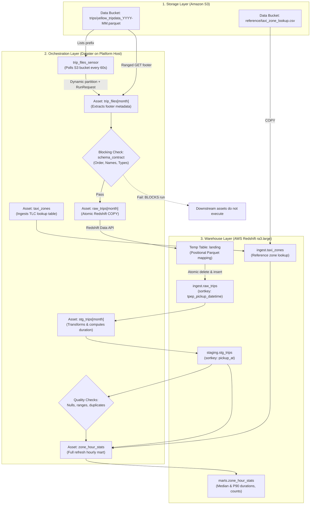

# Day 1: Architecture, Foundations & System Execution Guide
**Project:** `nyc-taxi-mlops-lab` | **Environment:** AWS Academy Learner Lab (`us-east-1`)  
**Student:** `anand24mishra` | **Date:** 2026-11-21

---

## 1. Executive Summary & Core Problem

### The Business Challenge
In a ride-hailing app (like Uber or Lyft), customers requesting rides require accurate estimated trip duration quotes before booking. Quoting poorly degrades user trust:
- **Under-quoting**: Leads to unhappy riders who miss appointments and complain to support.
- **Over-quoting**: Deters price/time-sensitive riders who choose competing transit options.

### The Baseline vs. Target State
- **Baseline (Stub)**: Quotes a static median ($12.25$ minutes) regardless of pickup location, destination, time of day, or day of week.
- **Target System (Production MLOps)**: An end-to-end, automated machine learning platform that ingests raw monthly parquet trip datasets, transforms features in a cloud data warehouse (AWS Redshift), trains gradient-boosted decision trees (LightGBM) tracked in MLflow, validates models against strict automated quality gates, serves real-time predictions via zero-downtime blue-green deployments, continuously monitors for data drift, and provides an LLM support assistant backed by Model Context Protocol (MCP) to explain prediction quotes.

---

## 2. High-Level Architectural View

```mermaid
flowchart TD
    subgraph ClientLayer ["1. Client & Traffic Ingress"]
        Rider["Rider / API Client"] -->|HTTP Port 80| Traefik["Traefik Reverse Proxy<br/>(Blue/Green Router)"]
    end

    subgraph AppHost ["2. App Host (EC2 Graviton / lab-app)"]
        Traefik -->|Internal 8000| AppAPI["App Backend (FastAPI)<br/>/predict & /version"]
        AppAPI -->|Internal 8001| Serving["Model Serving Engine<br/>(MLflow PyFunc)"]
        AppAPI -->|Internal 8002| MCPServer["MCP Server<br/>(Support Assistant Tools)"]
    end

    subgraph PlatformHost ["3. Platform Host (EC2 Graviton / lab-platform)"]
        Dagster["Dagster Orchestrator<br/>(Port 3000)"]
        MLflow["MLflow Tracking & Registry<br/>(Port 5000)"]
        Postgres["RDS PostgreSQL<br/>(Dagster & MLflow DB)"]
    end

    subgraph DataWarehouse ["4. Storage & Warehouse Layer"]
        S3Data["Instructor S3 Bucket<br/>(Trips Parquet & Zones)"]
        S3Artifacts["Student Artifact S3 Bucket<br/>(MLflow Artifacts & Models)"]
        Redshift["AWS Redshift Data Warehouse<br/>(Schemas: ingest, staging, marts)"]
    end

    subgraph LLMHost ["5. LLM Host (EC2 Graviton / lab-llm)"]
        LLMChat["LLM Chat Engine<br/>(:8080)"]
        LLMEmbed["Embedding Engine<br/>(:8081)"]
        VectorDB["Wiki Knowledge Base<br/>(RAG Support)"]
    end

    %% Interactions
    S3Data -->|Parquet Sensor| Dagster
    Dagster -->|Data API SQL| Redshift
    Dagster -->|Train & Register| MLflow
    MLflow -->|Saves Models| S3Artifacts
    MLflow -.->|Polls Champion/Challenger| Serving
    MCPServer -->|Read-Only SQL (lab_ro)| Redshift
    MCPServer -->|Query Predictions| Serving
    LLMChat -->|Queries Tools| MCPServer
    LLMChat -->|Retrieval| VectorDB
    Dagster --- Postgres
    MLflow --- Postgres
```

---

## 3. Deep Theoretical Foundations: How, Why & What Happens

### A. Spatio-Temporal Modeling with LightGBM
1. **Why LightGBM for Taxi Duration?**
   - Trip duration is fundamentally non-linear with sharp combinatorial thresholds (e.g., crossing Manhattan bridges during rush hour vs. 3 AM).
   - Deep neural networks on tabular spatio-temporal data typically require massive tuning, suffer from training-serving latency overhead, and struggle with categorical identifiers (`PULocationID`, `DOLocationID`).
   - LightGBM uses **Histogram-based Gradient Boosting Decision Trees (GBDT)** with **Leaf-wise (best-first) tree growth**. This dramatically cuts memory usage and training time while capturing complex feature interactions (zone pair $\times$ pickup hour $\times$ weekday).

2. **How Features are Engineered (`contracts/features.yaml`)**:
   - `pickup_zone_id`, `dropoff_zone_id`: Categorical location indices.
   - `pickup_hour`, `pickup_day_of_week`: Cyclic temporal attributes.
   - `haversine_distance`: Approximate spatial geodesic distance computed from zone centroid coordinates.
   - *Strict Guardrail*: Inputs known only *after* the ride concludes (actual meter fare, real dropoff time, congestion surcharge) are strictly prohibited from the feature contract to eliminate data leakage.

### B. Declarative Orchestration: Software-Defined Assets (Dagster)
1. **Why Dagster over Airflow / Legacy Task DAGs?**
   - Traditional workflow engines execute black-box tasks (`TaskA -> TaskB`). If a task succeeds, the engine doesn't verify whether the data produced conforms to contract.
   - Dagster operates on **Software-Defined Assets (SDAs)**. An asset is an explicit mapping between code, its upstream dependencies, and the durable data object it materializes.
2. **Partitioning & Sensors**:
   - Monthly yellow taxi parquet files (`yellow_tripdata_YYYY-MM.parquet`) are discovered dynamically by a file sensor on S3.
   - The sensor yields dynamic partition keys (`YYYY-MM`), instantiating isolated backfill/incremental pipelines for each month.
   - Blocking asset checks validate Parquet footers and schema types against `contracts/trips.schema.yaml` *before* issuing Redshift `COPY` commands.

### C. Serverless Data Access: AWS Redshift Data API
1. **Why Redshift Data API instead of a persistent JDBC/connection pool?**
   - Traditional database connections require long-lived TCP sockets, credential rotation in code/containers, and pool management that fails under container restarts or lambda spikes.
   - The **Redshift Data API** is an HTTPS REST interface. Dagster and the MCP server submit SQL statements asynchronously using temporary IAM credentials (`--db-user labadmin` or `--db-user lab_ro`).
   - Transactions are batched into single execution calls, guaranteeing atomic table swaps without long-lived database locks.

### D. Zero-Downtime Blue-Green Deployment with Traefik
1. **How It Works**:
   - Two container stacks (`app-blue` and `app-green`) run side-by-side on the app host.
   - Traefik acts as a dynamic reverse proxy reading Docker labels or volume states.
   - When a new image is deployed:
     1. The inactive color is updated with the new image and started.
     2. Health checks (`/healthz`) poll until the container reports ready.
     3. Traefik atomically cuts traffic over to the newly verified color.
     4. If health checks fail, traffic remains on the active color with zero dropped requests.

### E. Model Promotion & Approval Gate
1. **Challenger vs. Champion Lifecycle**:
   - When a new model trains in Dagster, automated asset checks benchmark its metrics (MAE, RMSE, latency) against baseline thresholds.
   - If checks pass, the pipeline tags the model with the **`challenger`** alias in MLflow.
   - **Never auto-promote to production**: Promoting a model to **`champion`** is an explicit human decision. GitHub Actions uses a protected `production` environment with manual approval gates. Only when a human signs off does the promote workflow point the `champion` alias at the candidate model.

---

## 4. Platform Constraints (AWS Academy Learner Lab)

| Restriction | Why It Exists in Learner Lab | Architectural Solution |
| :--- | :--- | :--- |
| **No IAM Creation** | Learner Lab policies prevent `iam:CreateRole`, `iam:CreatePolicy`, etc. | Use pre-created `arn:aws:iam::<account>:role/LabRole` and `LabInstanceProfile`. |
| **No `aws_s3_bucket` in Terraform** | Learner Lab SCP denies `s3:GetBucketObjectLockConfiguration`, breaking Terraform plans. | Use custom module `infra/modules/bucket` (invokes AWS CLI underneath). |
| **Graviton Hosts (`linux/arm64`)** | Cost-performance optimization on EC2 instances. | All Docker images must be cross-built for `linux/arm64`. |
| **No ECR Write** | `LabRole` has read-only access to ECR. | Container registry is GitHub Container Registry (`ghcr.io/{owner}/{repo}/{image}`). |
| **No SSH / Port 22 Closed** | Security boundary enforcement on student VPCs. | Shell access and UI access strictly via **AWS Systems Manager (SSM)** Session Manager and port-forwarding. |

---

## 5. Stage S0: The Walking Skeleton (Detailed Notes)

### What is a "Walking Skeleton"?
In software engineering, a **walking skeleton** is an implementation of the thinnest possible slice of real business functionality that links the entire architectural system together from end to end:
```
Git Commit (Local) ──> GitHub Actions CI (ubuntu) ──> Build arm64 Image ──> Push to GHCR
                                                                                │
AWS EC2 (lab-app) <── Self-Hosted Runner (Docker Compose) <─────────────────────┘
       │
    Traefik (Port 80) ──> FastAPI App (:8000) ──> Returns /version (Git SHA) & /predict (Stub)
```

### Why Build This First?
1. **De-risking Deployment**: Building complex ML models first often results in deployment deadlocks (missing system libraries, network timeouts, auth errors). Proving the deployment pipeline with a simple stub guarantees that when intelligent models arrive, shipping them to users takes zero extra overhead.
2. **Deterministic Feedback Loop**: Developers immediately verify changes live in under 2 minutes after pushing to `main`.
3. **Validating Cloud Infrastructure**: Verifies that Terraform state locking, EC2 Graviton instances, SSM communication, and security group routing work as designed.

### Key Technologies Used in Stage S0:
1. **Terraform 1.17**:
   - Manages infrastructure as code.
   - State stored in remote S3 bucket `lab-tfstate-062781275914` with native S3 lockfile (no DynamoDB table needed).
   - `infra/live/main.tf` orchestrates:
     - `module.app`: EC2 Graviton instance running Traefik and App backend.
     - `module.platform`: EC2 Graviton instance for Dagster and MLflow.
     - `module.llm`: EC2 Graviton instance for future LLM chat and embeddings.
     - `module.rds`: AWS RDS PostgreSQL instance for Dagster/MLflow metadata.
     - `module.artifact_bucket`: S3 bucket for model artifacts.
     - `module.wiki_secret`: Secrets Manager container for wiki docs.
2. **Traefik v3.7 (Reverse Proxy)**:
   - Listens on public HTTP port 80.
   - Forwards traffic internally to `app:8000`.
   - Traefik uses file providers (`traefik.yaml`), avoiding mounting the host Docker socket directly for strict security hardening.
3. **AWS Systems Manager (SSM) Run Command**:
   - Executes commands on EC2 instances over HTTPS via the AWS SSM agent.
   - Enables fully automated host registration as a GitHub Actions runner without opening port 22 or managing SSH private keys.
4. **GitHub Container Registry (GHCR)**:
   - Hosts our `linux/arm64` container images at `ghcr.io/anand24mishra/nyc-taxi-mlops-lab/app:<tag>`.
5. **Docker Compose v5**:
   - Manages service lifecycle on the host with `restart: unless-stopped`. When Learner Lab restarts instances, the stack comes back up automatically.

---

## 6. S0 Decision Records

### Decision 001: Runner Credentials
- **Choice**: The self-hosted runner on the EC2 host uses the attached **`LabInstanceProfile`** via IMDSv2.
- **Rejected Alternative**: Storing static session tokens in GitHub Secrets.
- **Why**: Learner Lab tokens expire every 4 hours. Static tokens break deployments every 4 hours; instance profiles never expire and require zero manual maintenance.

### Decision 002: Image Tagging Strategy
- **Choice**: Short Git commit SHA (`sha-${GITHUB_SHA::7}`).
- **Rejected Alternative**: Mutable `:latest` or manual SemVer (`v1.0.0`).
- **Why**: Git SHAs are immutable, deterministic, and make rollback instant (point Compose to previous commit SHA).

### Decision 003: Ingress Scope
- **Choice**: Restrict port 80 HTTP ingress to student laptop IP (`115.244.141.202/32`) and grader IP.
- **Rejected Alternative**: Open to `0.0.0.0/0`.
- **Why**: Eliminates malicious Internet bots and vulnerability scrapers from overwhelming the small lab EC2 instances.

---

## 7. Execution Log & Status

- **2026-11-21 09:05**: Public repo initialized and upstream tracked (`balwa/nyc-taxi-mlops-lab`).
- **2026-11-21 09:15**: Initial `make check` passed green.
- **2026-11-21 11:39**: AWS credentials configured for Account `062781275914` in `us-east-1`.
- **2026-11-21 11:40**: State bucket `lab-tfstate-062781275914` bootstrapped via `infra/bootstrap/state-bucket.sh`.
- **2026-11-21 11:41**: Terraform root module wired (`main.tf`, `security.tf`, `outputs.tf`, `terraform.tfvars`).
- **2026-11-21 11:42**: `terraform plan` executed: **Plan: 28 to add, 0 to change, 0 to destroy**.
- **2026-11-21 11:43**: Implemented `scripts/register-runner.sh` (SSM-based self-hosted runner setup).
- **2026-11-21 11:43**: Implemented `.github/workflows/ci.yaml` and `.github/workflows/pr.yaml` (Actionlint and repo workflow rules compliant).
- **2026-11-21 11:45**: Drafted decision records `001-runner-credentials.md`, `002-image-tag-scheme.md`, `003-ingress-scope.md`.
- **2026-11-21 11:51**: User approved `terraform apply` -> 28 resources successfully provisioned on AWS in `us-east-1` (3 EC2 Graviton hosts, RDS Postgres instance, artifact S3 bucket, secret containers, security groups).
- **2026-11-21 11:58**: Registered self-hosted runner `lab-app` on EC2 (`i-071591009d55bdf07`) via SSM with latest runner `v2.338.2`. Runner reported `online`.
- **2026-11-21 12:02**: GitHub Actions `ci.yaml` ran end-to-end:
  - `check`: green (1m 57s)
  - `image`: built `linux/arm64` container image and pushed to GHCR (31s)
  - `deploy`: deployed image on `lab-app` self-hosted EC2 runner with Traefik + FastAPI (27s)
- **2026-11-21 12:06**: Live HTTP verification on public IP `34.196.103.251`:
  - `GET /version` -> `200 OK` (returns git SHA `5527a2f...` and image tag `sha-5527a2f`)
  - `POST /predict` (valid) -> `200 OK` (returns static median quote `12.25` min)
  - `POST /predict` (invalid zone `9999`) -> `422 Unprocessable Entity`
- **2026-11-21 12:07**: Local `make check` verified 100% green. Stage S0 is **COMPLETE**!

---

## 8. Stage S1: Automated Data Pipeline & Data Warehousing

### 8.1 Objective & Overview
Stage S1 transitions the system from static stub predictions to a live, automated data pipeline. Whenever a raw monthly taxi trip dataset (`yellow_tripdata_YYYY-MM.parquet`) lands in the instructor's S3 data bucket, the pipeline must:
1. Detect the file automatically via an **S3 sensor** (zero manual button clicks).
2. Validate the file's Parquet schema against the frozen contract (`contracts/trips.schema.yaml`) via a **blocking asset check** (`schema_contract`).
3. Load the data idempotently into an **AWS Redshift Data Warehouse** (`ingest.raw_trips`).
4. Stage, clean, and enrich the trip records (`staging.stg_trips`).
5. Run **data-quality checks** (validating durations, zones, passenger counts, and row counts).
6. Aggregate hourly summary statistics per pickup zone into the analytics mart (`marts.zone_hour_stats`) for downstream training and MCP tools.

---

### 8.2 Architectural View of Stage S1



---

### 8.3 Core Theoretical Concepts: How & Why It Works

#### 1. Columnar Storage & Parquet Footer Reading
- **The Problem**: A raw monthly trip dataset can be 50–100 MB compressed and contain 3–4 million rows. Downloading 12 months just to check column names wastes bandwidth, disk space, and time.
- **How Parquet Works**: Unlike CSV (which is row-oriented and requires reading from byte 0 to find headers and row boundaries), Apache Parquet is a **columnar storage format**. It writes metadata and the schema definition into the **file footer** at the very end of the file.
- **Ranged GETs**: HTTP and S3 support `Range: bytes=-N` headers. By fetching only the final few kilobytes containing the `FileMetaData` thrift structure, PyArrow / Dagster can decode the exact column names, storage types (`INT32`, `DOUBLE`, `TIMESTAMP_MICROS`), and total row count in milliseconds without downloading the gigabytes of column chunk data!

#### 2. AWS Redshift & The Data API
- **Massively Parallel Processing (MPP) & Columnar Engine**: Redshift stores data by column rather than row. When computing `percentile_cont(0.5) within group (order by duration_min)`, Redshift only reads the `duration_min` column off disk, skipping all other 15 columns.
- **Sort Keys & Zone Maps**: Redshift organizes table blocks in 1 MB chunks. For each 1 MB block of a sorted column, Redshift maintains **Zone Maps** (minimum and maximum values). When a query filters `where pickup_at between '2024-03-01' and '2024-03-31'`, Redshift skips entire 1 MB blocks whose Zone Maps don't overlap, eliminating 95%+ of disk I/O.
- **Redshift Data API**: Traditional database drivers (ODBC/JDBC/psycopg2) require opening a persistent TCP socket to port 5439, storing static database passwords, and configuring complex VPC routing. The **AWS Redshift Data API** allows running asynchronous SQL statements over standard HTTPS AWS SDK calls authenticated via the instance profile's temporary IAM credentials (`--db-user labadmin`). No open database ports, no static passwords, no VPC NAT gateway needed!

#### 3. Idempotency & Atomic Landing Transactions
- **What is Idempotency?**: An operation is idempotent if executing it multiple times produces the exact same system state as executing it once ($f(f(x)) = f(x)$).
- **The Risk**: If an ingest job fails halfway or is retried after a transient network blip, a naive `INSERT INTO` duplicates millions of rows, corrupting metrics and model training.
- **How We Solve It**:
  Redshift executes multiple statements in a single batch transaction via the Data API:
  ```sql
  create temp table landing ({cols});
  copy landing from 's3://.../yellow_tripdata_YYYY-MM.parquet' iam_role default format as parquet;
  delete from ingest.raw_trips where source_file = 'yellow_tripdata_YYYY-MM.parquet';
  insert into ingest.raw_trips select *, 'yellow_tripdata_YYYY-MM.parquet' from landing;
  drop table landing;
  ```
  - `landing` is a temporary table that exists only in the session memory.
  - `copy landing ...` uses positional Parquet mapping.
  - `delete` cleans out any previously loaded rows for that specific month's file.
  - `insert` populates the official table with the provenance column `source_file`.
  - All statements run in **one transaction**: if any step fails, the entire batch rolls back automatically. Re-running the month 100 times will always result in exactly 1 copy of the month's rows.

#### 4. Sensors vs. Schedules in Dagster
- **Schedule**: Triggers execution on a fixed cron clock (e.g. `0 0 1 * *` = 1st of every month at midnight).
  - *When to use*: Batch reporting, nightly rollups, or periodic backups that must happen at predictable wall-clock times.
- **Sensor**: Evaluates external state (e.g., polling an S3 bucket or message queue every 60 seconds) and fires runs dynamically when state changes.
  - *When to use*: Event-driven architectures where upstream data arrival times are irregular, delayed, or unknown. The sensor tracks a `cursor` (e.g. `{ "2024-01": "etag1", "2024-02": "etag2" }`) so it only triggers runs when new files land or existing files are modified.

---

### 8.4 Recall Check: Core Questions & Answers

1. **Why can you read a Parquet file's schema without downloading the whole file?**
   - *Answer*: Parquet stores file metadata (including column schemas, field names, data types, and row group statistics) in the **footer** at the end of the file. Using HTTP / S3 byte-range requests (`Range: bytes=-N`), a client can fetch only the last few kilobytes of the file to deserialize the complete schema without transferring the multi-megabyte row data.

2. **In Redshift, what does a sort key change, and what does a distribution key change?**
   - *Answer*:
     - **Sort Key**: Determines the physical order in which rows are stored on disk within each slice/node. It populates block-level **Zone Maps** (min/max metadata per 1 MB block), allowing queries filtering or aggregating on the sort key to skip irrelevant blocks entirely.
     - **Distribution Key (Dist Key)**: Determines how rows are distributed across multiple compute nodes / slices in a cluster. Choosing the right distribution key co-locates matching join keys on the same physical node, eliminating network redistribution shuffle overhead during large joins.

3. **What makes a load safe to run twice? Give one way to make a monthly reload idempotent.**
   - *Answer*: A load is safe to run twice if it guarantees that re-executing it leaves the target database in the exact same state without row duplication or partial writes. A proven approach is an **atomic delete-and-insert in a single transaction** using a staging/landing table: copy into a session-scoped temporary table, delete existing records for that partition (`where source_file = '...'`), insert the new records, and commit.

4. **A sensor and a schedule both start runs. When would you use each?**
   - *Answer*:
     - Use a **Sensor** when runs depend on external event triggers whose timing is uncertain (e.g. S3 file arrival, message queue depth, external webhooks).
     - Use a **Schedule** when tasks are time-dependent and must run at predetermined wall-clock intervals regardless of upstream events (e.g. daily SLA rollups, weekly compliance reports, morning cache warmups).

---

### 8.5 The Three S1 Decision Points & Trade-offs

#### Decision 1: COPY vs. Redshift Spectrum
- **Option A (COPY)**: Physically loads parquet rows into Redshift managed columnar storage.
  - *Pros*: Fastest possible analytical query performance, local zone maps, full compression encoding, no per-query S3 scan cost.
  - *Cons*: Takes ~15–30 seconds to load per month, consumes Redshift cluster disk storage.
- **Option B (Spectrum)**: Queries Parquet files in place on S3 using external tables and a Glue data catalog.
  - *Pros*: Instant availability with zero load time, zero Redshift local disk usage.
  - *Cons*: Slower queries (data transferred over network on every query), costs $5 per TB scanned, requires Glue catalog setup.
- **Recommendation**: **COPY**. Our dataset is a fixed monthly batch; local storage provides optimal query speed for the hourly marts and subsequent feature extraction.

#### Decision 2: Quality Check Severity & Thresholds
- **Option A (Strict Blocking on Everything)**: Any row with null passengers, duration $\le 0$, duration $> 180$ min, or unknown zone immediately fails and aborts the entire run.
  - *Problem*: Real-world TLC taxi data inherently contains messy outliers ($< 1\%$ anomalous records). Hard-failing would block the entire monthly mart and stop model training for minor anomalies that downstream models can easily filter.
- **Option B (Layered: Schema Blocks, Quality Warns/Filters)**:
  - `schema_contract` on `trip_files` **BLOCKS** (Severity `ERROR`): If column count, order, or data types are wrong, positional COPY will fail or load corrupt columns into the database.
  - Data-quality checks on `stg_trips` **WARN** (Severity `WARN`) or use percentage thresholds (e.g., alert if bad rows exceed $5\%$): Bad rows are preserved in staging for auditability and filtered out by `zone_hour_stats.sql` (`where s.duration_min > 0 and s.duration_min <= 180 and s.pickup_zone_id between 1 and 263`).
- **Recommendation**: **Layered**. Schema blocks before COPY; data-quality checks warn unless corruption exceeds $5\%$.

#### Decision 3: Distribution & Sort Keys
- **Option A**: `diststyle auto sortkey (tpep_pickup_datetime)` for `raw_trips`, and `sortkey (pickup_at)` for `stg_trips`.
  - *Why*: Redshift `ra3.large` in Learner Lab is a single-node cluster (multi-node distribution is inactive, so `diststyle auto` lets Redshift manage it seamlessly). Sorting on pickup timestamps accelerates time-range filtering, monthly aggregations, and feature extraction.
- **Recommendation**: `diststyle auto sortkey (tpep_pickup_datetime)` on `raw_trips`, `sortkey (pickup_at)` on `stg_trips`.

---

### 8.6 S1 Execution, Ingestion & Verification Log

#### 1. Pipeline Ingestion Summary
- **Data Source**: Public bucket `nst-mlops-2026` in `us-east-1`
- **Partitions Materialized**:
  - `2024-01`: 2,964,624 rows (Schema check passed, duplicate check warned at 1.05%, materialization successful)
  - `2024-02`: 3,007,526 rows (Schema check passed, materialization successful)
  - `2024-03`: 3,582,628 rows (Schema check passed, materialization successful)
  - `2024-04`: 3,514,289 rows (Schema check passed, materialization successful)
- **Taxi Zones Reference**: 265 zones loaded into `ingest.taxi_zones`
- **Zone-Hour Stats Mart**: 5,801 hourly rows computed across 260 distinct zones.

#### 2. Verification Query: `marts.zone_hour_stats` (JFK Airport)
Query executed on Redshift:
```sql
select zone, pickup_hour, trip_count, median_duration_min
from marts.zone_hour_stats
where zone = 'JFK Airport'
order by pickup_hour;
```

**Results (All 24 hours present, matching realistic traffic curves):**
| Pickup Hour | Zone | Trip Count | Median Duration (min) | Traffic Insight |
| :---: | :--- | :---: | :---: | :--- |
| **0** (12 AM) | JFK Airport | 23,714 | 31.57 | Late night arrivals, light highway traffic |
| **1** (1 AM) | JFK Airport | 9,256 | 29.43 | Low volume |
| **2** (2 AM) | JFK Airport | 3,264 | 25.92 | Lowest volume of the night |
| **3** (3 AM) | JFK Airport | 2,254 | 23.50 | Off-peak clear highways |
| **4** (4 AM) | JFK Airport | 2,397 | 22.30 | Fastest median travel time (22.3 min) |
| **5** (5 AM) | JFK Airport | 7,895 | 27.90 | Early departures start picking up |
| **6** (6 AM) | JFK Airport | 17,872 | 37.84 | Morning rush begins |
| **7** (7 AM) | JFK Airport | 20,188 | 44.35 | Morning peak traffic delay |
| **8** (8 AM) | JFK Airport | 15,698 | 41.63 | Sustained morning delay |
| **9** (9 AM) | JFK Airport | 14,508 | 35.91 | Mid-morning recovery |
| **10** (10 AM) | JFK Airport | 16,964 | 38.17 | Steady midday traffic |
| **11** (11 AM) | JFK Airport | 15,681 | 42.05 | Midday traffic |
| **12** (12 PM) | JFK Airport | 19,939 | 43.33 | Afternoon flight arrivals begin |
| **13** (1 PM) | JFK Airport | 27,537 | 47.60 | Increasing congestion on Van Wyck / BQE |
| **14** (2 PM) | JFK Airport | 35,221 | 50.65 | Heavy afternoon traffic |
| **15** (3 PM) | JFK Airport | 39,718 | 51.87 | Peak congestion (slowest median trip: 51.9 min) |
| **16** (4 PM) | JFK Airport | 44,471 | 50.65 | Highest trip volume of the day (44.5k trips) |
| **17** (5 PM) | JFK Airport | 38,999 | 48.62 | Evening rush hour |
| **18** (6 PM) | JFK Airport | 37,088 | 43.27 | Evening rush hour tapering |
| **19** (7 PM) | JFK Airport | 40,338 | 37.80 | Flight arrival wave |
| **20** (8 PM) | JFK Airport | 37,622 | 34.12 | Decreasing travel duration |
| **21** (9 PM) | JFK Airport | 38,621 | 32.42 | Smooth evening transit |
| **22** (10 PM) | JFK Airport | 39,769 | 32.60 | Late evening arrival wave |
| **23** (11 PM) | JFK Airport | 37,793 | 33.93 | Final night arrival wave |

#### 3. Health & Grader Status Verification
- `scripts/health.sh`:
  - `OK session user4756121=anand.mishra2024@nst.rishihood.edu.in`
  - `OK app running, 34.196.103.251, runner online`
  - `OK platform running, 50.19.131.109, runner online`
  - `OK rds available`
  - `OK redshift available`
  - `OK status Dagster answered the status run 1 min ago`
- `status.yaml` workflow passed and uploaded `lab-status.json` with all 4 partitions materialized and checks verified.


